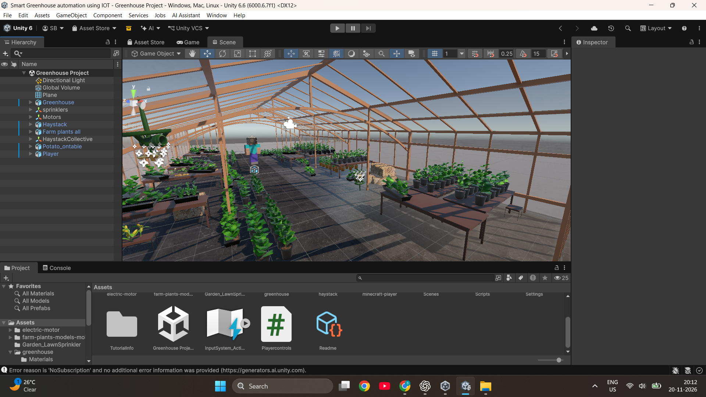
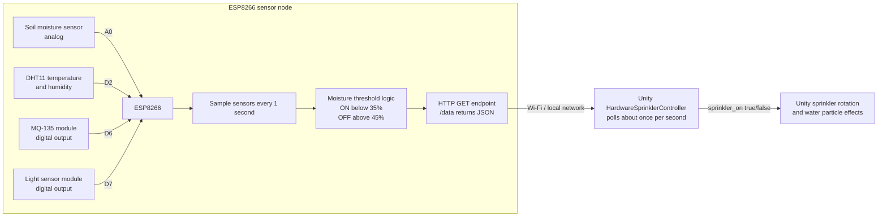
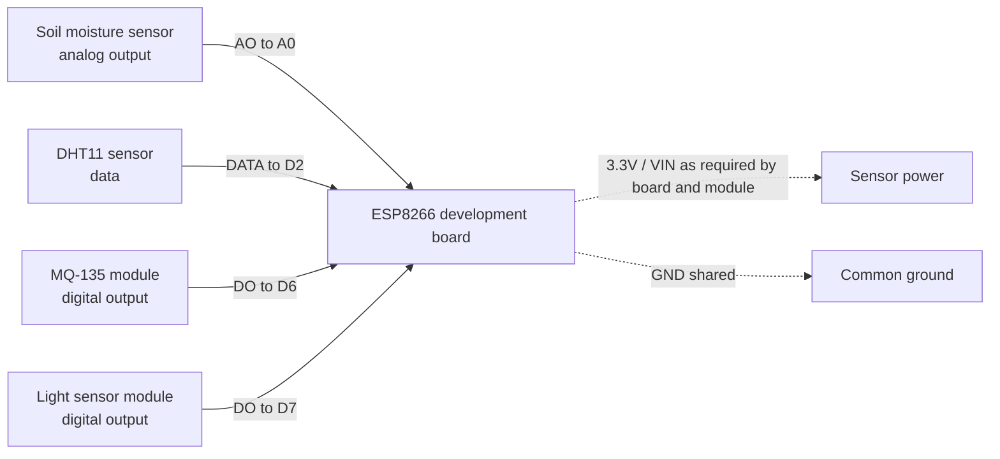

# Smart Greenhouse Automation using IoT

A Unity greenhouse simulation connected to an ESP8266 sensor node over a local Wi-Fi network. The firmware samples soil moisture, temperature, humidity, air-quality module output, and light module output. Unity reads the sensor node's sprinkler state and represents watering with animated sprinkler heads and water particle effects.

## How it works

The firmware exposes the latest readings as JSON at `http://<ESP8266-IP>/data`. Replace the example IP in `Assets/Scripts/hardwaresprinklercontroller.cs` with the address printed by the ESP8266 on startup. The computer running Unity and the ESP8266 must be able to reach each other on the same network. If a request fails, Unity turns off the simulated sprinklers.

Soil moisture is mapped from calibrated dry and wet ADC readings to 0–100%. The 35% ON and 45% OFF thresholds provide hysteresis, preventing rapid switching around a single threshold. Temperature and humidity come from the DHT11. The MQ-135 and light modules are read as digital HIGH/LOW signals; the current firmware does not report calibrated gas concentration or measured light intensity.

## Pin connection diagram

| Device signal | ESP8266 pin | Firmware name | Notes |
| --- | --- | --- | --- |
| Soil sensor analog output (AO) | A0 | `SOIL_PIN` | ESP8266 has one analog input. Check your board's A0 voltage range before connecting a sensor module. |
| DHT11 data | D2 (GPIO4) | `DHTPIN` | Use the correct DHT11 module wiring; a bare sensor may need a pull-up resistor. |
| MQ-135 digital output (DO) | D6 (GPIO12) | `MQ135_PIN` | Firmware reads a digital state only. Ensure the module output is safe for the ESP8266's 3.3 V GPIO. |
| Light sensor digital output (DO) | D7 (GPIO13) | `LDR_PIN` | Firmware reads a digital state only, not analog light level. |
| Sensor supply and ground | Board/module power and GND | — | Share ground. Use the voltage required by each module and board; do not apply 5 V to ESP8266 GPIO. |

The firmware does **not** define a physical pump/relay output. The sprinkler is currently a Unity visual simulation driven by the `sprinkler_on` JSON field. Add a properly rated, isolated driver and a firmware output pin before controlling a real pump; never power a pump directly from an ESP8266 GPIO.

## Run the project

1. Open this folder in Unity (the project was authored with Unity 6).
2. Install the ESP8266 Arduino core and the `DHT` library in Arduino IDE.
3. In `unity.ino`, configure your Wi-Fi credentials locally, select the ESP8266 board, and upload the firmware. Do not commit personal credentials.
4. Read the IP address printed in the Arduino Serial Monitor and set the URL in `HardwareSprinklerController` to `http://<ESP8266-IP>/data`.
5. In Unity, open the greenhouse scene, ensure the controller's sprinkler references and particle systems are assigned, then press Play.

The Unity-only `SprinklerController` also supports a Space key toggle for standalone scene interaction.

## Repository layout

- `unity.ino` — ESP8266 sensor sampling and `/data` JSON server.
- `Assets/Scripts/hardwaresprinklercontroller.cs` — polls the ESP8266 and drives simulated sprinkler effects.
- `Assets/Garden_LawnSprinkler/SprinklerController.cs` — standalone Unity sprinkler behavior.
- `Assets/Playercontrols.cs` — first-person player movement and mouse look.
- `webpreview.png` — greenhouse scene preview.
